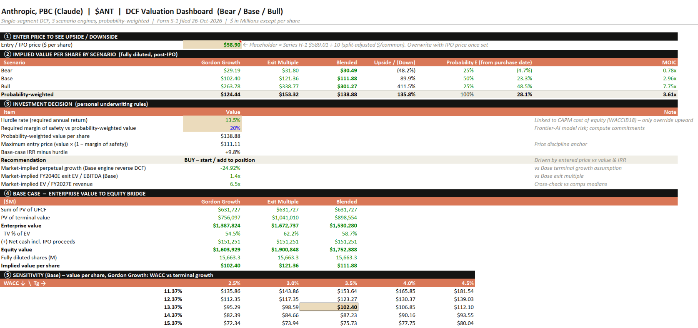
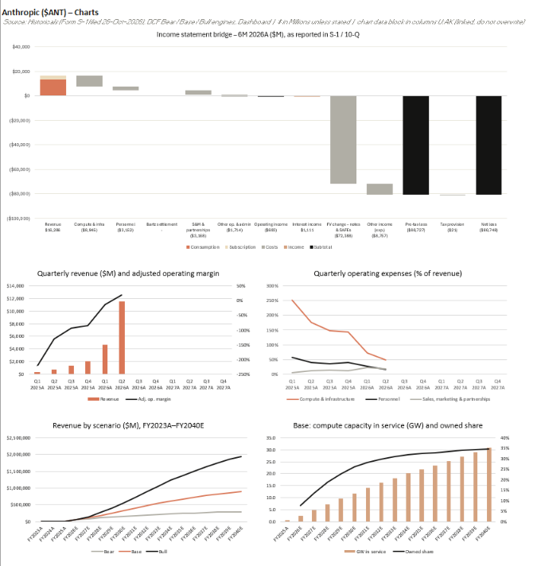

# Investment Case: Anthropic

A research-driven valuation and investment analysis pack for Anthropic, covering its AI platform economics, operating drivers, single-segment DCF framework, source library, and model update process.

[](08_Output/Cover.png)

## Overview

This repository contains an institutional-style investment case built around a maintained single-segment DCF model with bear, base, and bull scenarios. The model links revenue, customer adoption, pricing, operating costs, and compute requirements to cash flow and valuation, supported by primary sources, third-party research, operating data, comparable-company analysis, and output materials.

The model and research base are designed to be updated as new financial disclosures, customer and adoption metrics, API pricing, funding rounds, partnerships, compute commitments, and industry data become available. Sources, assumptions, scenarios, and outputs can be reviewed and refreshed without rebuilding the analysis from scratch.

## What the Model Contains

The Excel workbook is structured around an executive summary, valuation dashboard, bear/base/bull DCF scenarios, operating drivers, compute commitments, comparable-company analysis, and supporting financial data.

| Tab | Purpose |
| --- | --- |
| Exec Summary | High-level valuation output and investment-case summary. |
| Dashboard | Entry price, scenario values, probability weighting, decision rules, EV-to-equity bridge, and sensitivity analysis. |
| Graphs | Historical and forecast financial, margin, scenario, and compute-capacity charts. |
| DCF Base | Base-case operating forecast and discounted cash flow. |
| DCF Bear | Downside operating forecast and discounted cash flow. |
| DCF Bull | Upside operating forecast and discounted cash flow. |
| Drivers | Operating, revenue, cost, and compute assumptions. |
| WACC | Cost of capital and terminal-value assumptions. |
| Commitments | Contractual obligations, compute-linked facilities, and coverage tests. |
| Ratios | Financial, operating, and valuation ratios. |
| Comps | Comparable-company trading analysis. |
| Actuals | Reported financial and operating data. |
| Historicals | Historical financial statements and supporting schedules. |

[](08_Output/Charts.png)

The charts summarise historical and forecast financial performance, margins, scenario outcomes, and compute capacity.

[](08_Output/Compute%20Commitments.png)

The commitments schedule presents contractual obligations, compute-linked facilities, and related coverage tests.

The workbook is a working valuation file rather than a static output. Operating assumptions, DCF scenarios, comparable-company inputs, WACC, commitments, historical data, and reported actuals can be refreshed as the research base evolves.

## Repository Structure

The repository is organized as a complete valuation pack with the following folder purposes:

```text
00_Index.xlsx              Central index of key sources and files.
01_Filings                 Primary filings, regulatory documents, government disclosures, and official source documents.
02_Investor_Materials      Company presentations, investor materials, fundraising documents, factsheets, and management materials.
03_Financial_Reporting     Reserved for actual financial reports, earnings materials, and formal performance disclosures.
04_Research                Broker reports, industry reports, competitor research, TAM studies, and valuation research.
05_News                    News articles, funding rounds, M&A announcements, major contracts, and important developments.
06_Operating_Data          Model input datasets such as funding and valuation history, API pricing, partnerships, compute commitments, and disclosed KPIs.
07_Model                   Current Excel valuation model and space for future archived versions.
08_Output                  Current dashboard, charts, and compute-commitment outputs, plus space for future finished reports and presentation decks.
```

## Updating the Model

The repository is designed for periodic maintenance as new information becomes available.

Quarterly updates may include:

- Update revenue, adoption and customer metrics, and API pricing.
- Reconcile compute capacity, contracted facilities, and related commitments.
- Refresh comparable-company trading multiples.
- Update WACC assumptions.
- Reconcile reported actuals and management commentary.

Annual updates may include:

- Rebuild historical financial statements and supporting schedules.
- Refresh long-term revenue, margin, capital expenditure, and working-capital assumptions.
- Review compute-capacity requirements and contractual obligations.
- Review bear, base, and bull DCF scenario assumptions.
- Update TAM and industry research.
- Archive prior model versions.

## Intended Use

This repository can be used for:

- Learning valuation modelling.
- Understanding Anthropic's business model and operating economics.
- Practising investment research workflows.
- Tracking private-company operating, pricing, and compute assumptions.
- Building repeatable investment case repositories.

## Disclaimer

This project is for educational and research purposes only. It is not financial advice, investment advice, or a recommendation to buy or sell any security.
